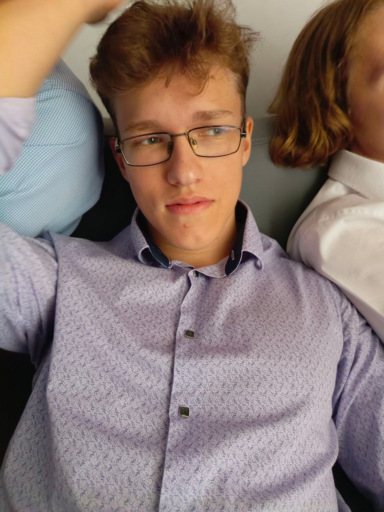

  

    
Портфолио · ИТМО · 2026

    <h1 class="hero__title">Иван «Банан» Пушкин</h1>
    

      Студент программной инженерии <strong>НИУ ИТМО</strong>, пишу на Python.
      За плечами <strong>22 хакатона</strong>, с июля 2026 года — в команде
      <a href="https://nedovost.org">«недовосторг»</a>. Победы на ML4Pay, «Время IT» и «Открой #Моспром», второе место на хакатоне Островка, четыре третьих места и финал КосмоХакатона.
    

    

      <a class="md-button md-button--primary" href="about/">Обо мне</a>
      <a class="md-button" href="about/#hackathons">Хакатоны</a>
    

  

  

    
    
    <button class="hero__sticker" type="button" data-banana-rain title="Нажми на банан" aria-label="Банановый дождь">
      
    </button>
    ↑ нажми на банан
  

  
I ×3первых места: ML4Pay, «Время IT», «Открой #Моспром»

  
IIместо на хакатоне Островка

  
III ×4третьих места на хакатонах

  
22хакатона, код — на GitHub

## Избранные проекты

[Все хакатоны →](about.md#hackathons)

  <a class="project" href="https://github.com/Ivana-banana/Lassard">
    «Открой #Моспром» · ЛАССАРД · окт 2026I место
    Шоурум ЛАССАРД
    Концепция шоурума лазерного производителя и продукт к ней: гид по маршруту на телефоне, экраны зон и 3D-планировщик зала.
    React · three.js · FastAPI · PostgreSQL
  </a>
  <a class="project" href="https://github.com/Ivana-banana/Ostrovok">
    Хакатон Островка · окт 2026II место
    «О!дин запрос» — агент путешествий
    Из одного сообщения — готовая поездка: направления, отели, транспорт, план со стыковками и бронь; при новых условиях пересобирает только зависимое.
    Python · FastAPI · React
  </a>
  <a class="project" href="https://github.com/Ivana-banana/Valaroma">
    «Время IT» · ГУАП × «Звук» · окт 2026I место
    Valaróma — караоке-баттл
    Браузерная игра: поёшь в микрофон, мелодия и ритм оцениваются отдельно, под баллами — где и как ошибся.
    TypeScript · React · Web Audio · FastAPI
  </a>
  <a class="project" href="https://github.com/Ivana-banana/DS">
    ML4Pay · Авито × ИТМО · май 2026Победители
    Возвраты в Авито Доставке
    Предсказание возврата заказа на 29 млн строк истории: бленд LightGBM и CatBoost с target encoding.
    Python · LightGBM · CatBoost
  </a>
  <a class="project" href="https://nedovost.org/projects/max-first-90-days">
    Хакатон MAX · сен 2026III место
    Первые 90 дней иностранного студента
    Бот и мини-приложение в MAX ведут иностранного первокурсника через обязательные процедуры и присылают напоминания о сроках.
    TypeScript · Node.js · PostgreSQL
  </a>
  <a class="project" href="https://nedovost.org/projects/tram-odometry">
    Московский транспорт · сен 2026III место
    Трамвай без GNSS
    Резервная одометрия беспилотного трамвая: фильтр Калмана с детектором проскальзывания колёс.
    ROS 2 · Python · C++
  </a>

